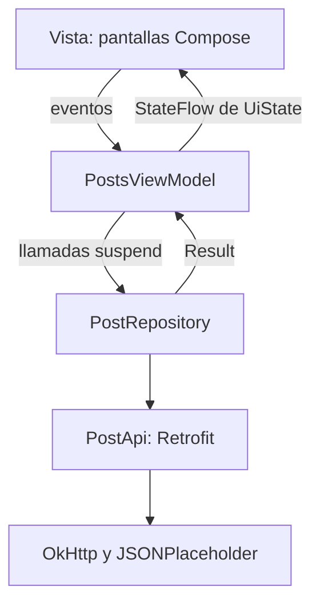
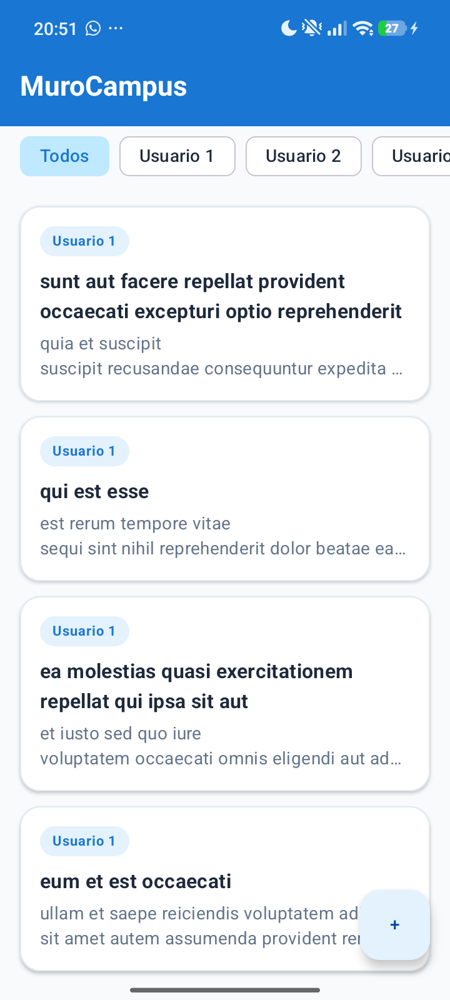
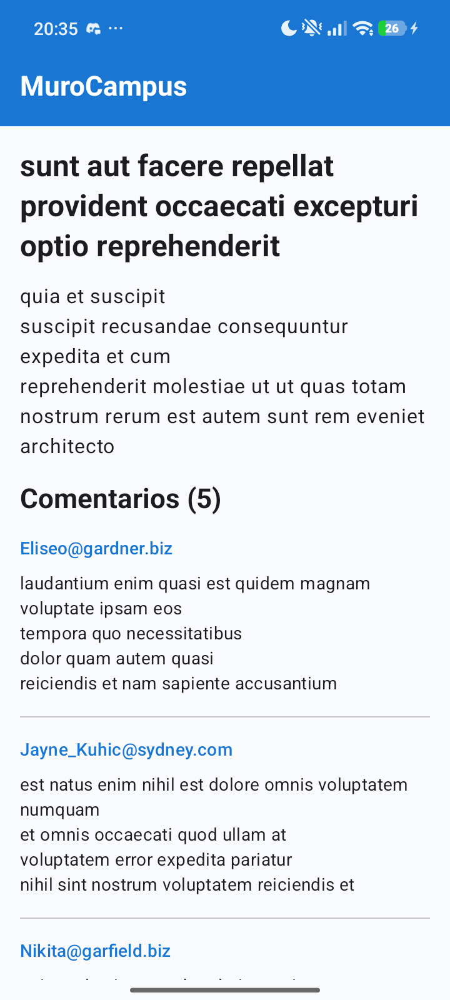
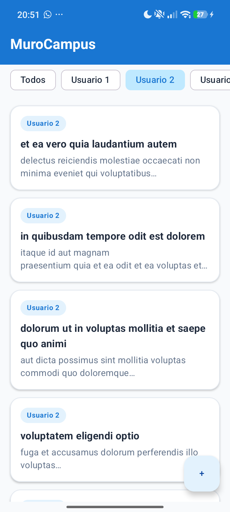
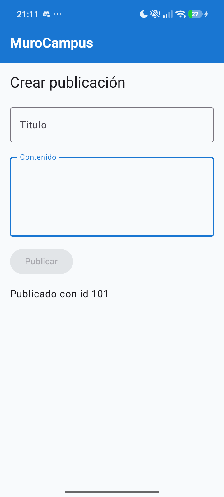
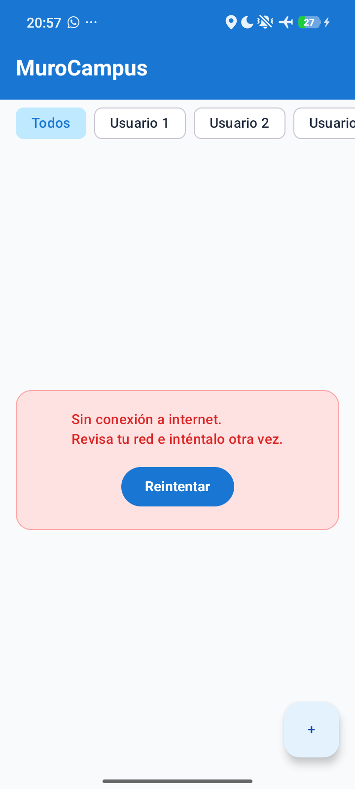

# MuroCampus

**Autor:** Jesús Rocha  
**Curso:** Programación en Móviles, semana 09

MuroCampus es una aplicación Android hecha con Jetpack Compose que consulta publicaciones de [JSONPlaceholder](https://jsonplaceholder.typicode.com/). Permite ver la lista, abrir una publicación con sus comentarios, filtrar por usuario y simular la creación de una publicación. Muestra estados de carga y mensajes de error cuando falla una petición.

## Estructura de paquetes

```text
com.tecsup.murocampus/
├── MainActivity.kt                 # Navegación entre lista, detalle y creación
├── model/
│   └── Modelos.kt                  # Post, Comentario y NuevoPost
├── data/
│   ├── PostRepository.kt           # Contrato y repositorio remoto con Result
│   └── remote/
│       ├── PostApi.kt               # Rutas GET y POST de Retrofit
│       └── RetrofitClient.kt       # Retrofit, OkHttp y conversor JSON
├── viewmodel/
│   ├── UiState.kt                   # Cargando, Exito y Error
│   ├── PostsViewModel.kt           # Estados y acciones de las pantallas
│   └── PostsViewModelFactory.kt
└── ui/
    ├── Componentes.kt              # Tarjeta, carga y error con reintento
    ├── PantallaLista.kt
    ├── PantallaDetalle.kt
    ├── PantallaCrear.kt
    └── theme/
```

## Arquitectura MVVM



La vista observa el estado y envía acciones al ViewModel. El ViewModel usa la interfaz del repositorio; el repositorio captura los fallos de red y devuelve `Result`.

## Capturas

| Lista | Detalle con comentarios |
| --- | --- |
|  |  |

| Filtro por usuario | Crear publicación | Error de conexión |
| --- | --- | --- |
|  |  |  |

## Pruebas realizadas

| Caso | Resultado |
| --- | --- |
| Sin internet | Mensaje «Sin conexión a internet» y botón Reintentar. |
| Reintentar al recuperar internet | La lista volvió a cargar con HTTP 200. |
| Publicación inexistente (id 9999) | Mensaje «Error del servidor (404)». |
| Campo obligatorio ausente en el JSON | Mensaje «Respuesta inesperada». |
| Lista y detalle | Las publicaciones 1, 2 y 3 mostraron cinco comentarios cada una. |
| Filtros Usuario 1–10 | Cada petición `posts?userId=N` devolvió diez publicaciones del usuario elegido. |
| Filtro Todos | Volvió a mostrar las 100 publicaciones. |
| Crear | Botón deshabilitado con campos vacíos; POST con HTTP 201 y mensaje «Publicado con id 101». |
| Cancelación | Al abrir el detalle y volver enseguida, la lista siguió visible y no hubo un cierre de la app. |

Los cambios temporales usados para provocar errores se retiraron. JSONPlaceholder simula el POST: la publicación creada no se guarda ni aparece luego en la lista.

## Para pensar

1. **¿Qué diferencia hay entre GET y POST? ¿Por qué `crear` lleva `@Body` y `porUsuario` lleva `@Query`?** GET consulta datos sin crear un recurso; POST envía datos para crear uno. `@Body` serializa la publicación nueva en el cuerpo JSON; `@Query` añade `userId` a la URL para filtrar la consulta.
2. **¿Por qué la ruta es `"posts"` y no `"/posts"`?** Retrofit resuelve `posts` respecto de la URL base. Una barra inicial indica una ruta absoluta desde la raíz del servidor y puede descartar el camino configurado en una URL base que lo tenga.
3. **¿Por qué el Repository devuelve `Result`?** Convierte los fallos en un valor que el ViewModel puede transformar en `UiState.Error`, mientras los éxitos se convierten en `UiState.Exito`. La cancelación de corrutinas se vuelve a lanzar para respetar el ciclo de vida.
4. **¿Qué ocurre sin `INTERNET` o sin `ignoreUnknownKeys`?** Sin el permiso, la app no puede hacer la petición y muestra un error de conexión. Sin `ignoreUnknownKeys`, un campo adicional del servidor puede causar un error de deserialización.
5. **¿Por qué usar `when` sobre `UiState`?** Los estados Cargando, Éxito y Error son excluyentes. `when` obliga a dibujar cada caso y evita combinaciones contradictorias de varias variables booleanas.
6. **¿Qué cambiaría con un servicio real?** El POST podría guardar la publicación. Tras recibir la respuesta, la app podría agregarla a la lista o volver a consultarla. También habría que atender autenticación, validación, errores reales del servidor y persistencia según el contrato de esa API.
