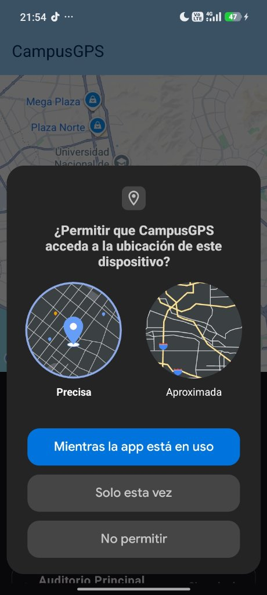
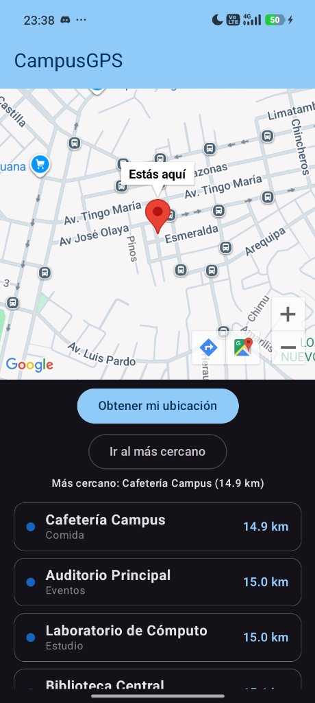
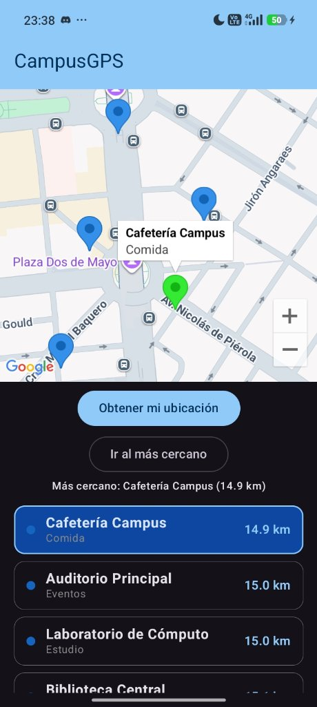
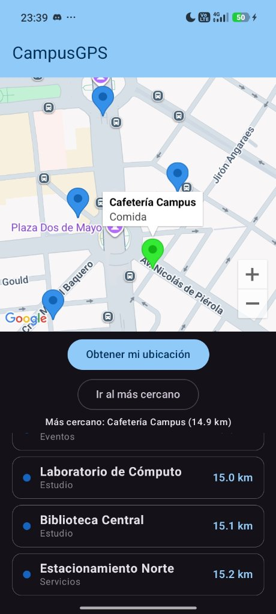
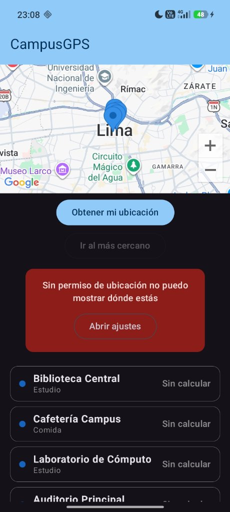
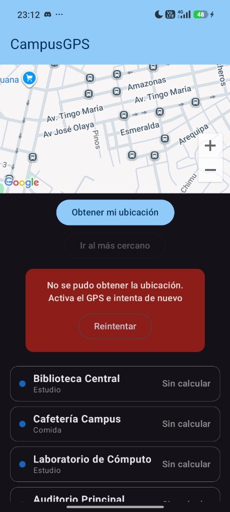

# CampusGPS: Sistema de Geolocalización y Guía del Campus Universitario

**Laboratorio N° 13: Localización Geográfica**  
**Desarrollado por:** Jesús Rocha  
**Docente:** Juan León S.  
**Institución:** Tecsup, Departamento de Tecnología Digital  
**Curso:** Programación en Móviles  

---

## 1. Visión General del Proyecto

CampusGPS es una aplicación móvil nativa para Android desarrollada con Jetpack Compose y Material 3 que funciona como un asistente geográfico en tiempo real dentro del campus universitario. El sistema permite al usuario conocer su ubicación geográfica exacta, medir su distancia hacia los principales edificios del campus y visualizar tanto su posición como los destinos a través de un mapa interactivo.

* **Propósito del sistema:** Orientar a la comunidad universitaria calculando la distancia geodésica hacia la biblioteca, cafetería, laboratorio de cómputo, auditorio y estacionamiento.
* **Obtención de coordenadas:** Solicita permisos en tiempo de ejecución y se conecta con Google Play Services para capturar la latitud y longitud mediante el proveedor de ubicación fusionada.
* **Visualización en mapa:** Anima la cámara de Google Maps hacia la posición del usuario con un marcador rojo y representa los cinco lugares del campus en color azul.
* **Identificación del punto más cercano:** Colorea en verde el marcador del lugar más próximo, ordenando de forma automática la lista inferior de menor a mayor distancia.
* **Navegación interactiva:** Permite tocar cualquier tarjeta o pulsar el botón de acceso directo para desplazar la cámara del mapa hacia ese destino y abrir su ventana informativa.

---

## 2. Arquitectura MVVM y Flujo de Datos

El diseño del software implementa una arquitectura por capas basada en Clean Architecture y las directrices oficiales de Android, asegurando un flujo de datos unidireccional y desacoplado:

```
┌────────────────────────────────────────────────────────────────────────┐
│                              VIEW (ui/)                                │
│                                                                        │
│   ┌───────────────────────┐          ┌─────────────────────────────┐   │
│   │     PantallaMapa      │  ──────> │        MapaUbicacion        │   │
│   │                       │          │   (GoogleMap, Marcadores)   │   │
│   │   • Solicita permisos │          └─────────────────────────────┘   │
│   │   • Acciones usuario  │          ┌─────────────────────────────┐   │
│   │                       │  ──────> │         ListaLugares        │   │
│   │                       │          │   (LazyColumn de tarjetas)  │   │
│   └───────────────────────┘          └─────────────────────────────┘   │
└───────────────────────────────────┬────────────────────────────────────┘
                     Eventos de UI  │  ▲  Observación reactiva
                     (buscar, etc.) │  │  StateFlow
                                    ▼  │
┌────────────────────────────────────────────────────────────────────────┐
│                        VIEWMODEL (viewmodel/)                          │
│                                                                        │
│                            MapaViewModel                               │
│                                                                        │
│    • estado: StateFlow de la interfaz                                  │
│    • lugares: StateFlow de la lista con distancias                     │
│    • masCercano: StateFlow del lugar más próximo                       │
│    • seleccionado: StateFlow del identificador seleccionado            │
│    • Regla de oro: El ViewModel no conoce Composables ni recibe Context│
└───────────────────────────────────┬────────────────────────────────────┘
                                    │ Consulta interfaces
                                    ▼
┌────────────────────────────────────────────────────────────────────────┐
│                          DATA / REPOSITORY                             │
│                                                                        │
│   ┌───────────────────────────────┐ ┌──────────────────────────────┐   │
│   │  Interfaz UbicacionRepository │ │  Interfaz LugaresRepository  │   │
│   └───────────────▲───────────────┘ └──────────────▲───────────────┘   │
│                   │                                │                   │
│   ┌───────────────┴───────────────┐ ┌──────────────┴───────────────┐   │
│   │ UbicacionRepositoryGoogle     │ │ LugaresRepositoryLocal       │   │
│   │ • FusedLocationClient         │ │ • 5 lugares fijos del campus │   │
│   │ • Disponibilidad Play Services│ │                              │   │
│   └───────────────────────────────┘ └──────────────────────────────┘   │
└────────────────────────────────────────────────────────────────────────┘
```

La interacción entre las capas del proyecto se organiza de la siguiente manera:

* **Capa de Presentación (View):** La vista se compone de funciones composables pasivas que observan el estado reactivo del ViewModel. PantallaMapa coordina la solicitud de permisos y el diseño general, MapaUbicacion gestiona el mapa de Google con sus marcadores y efectos de cámara, y ListaLugares renderiza las tarjetas desplazables con la distancia calculada.
* **Capa de Negocio (ViewModel):** MapaViewModel mantiene el estado de la pantalla mediante flujos StateFlow sin interactuar con el contexto de Android. Al recibir una coordenada válida, delega el cálculo geodésico a funciones de utilidad puras, actualiza la lista ordenada y expone reactivamente el punto más cercano.
* **Capa de Datos (Repository):** Se basa en contratos de interfaz para garantizar independencia tecnológica. UbicacionRepositoryGoogle interactúa con el cliente de ubicación de Google Play Services y comprueba la disponibilidad de los servicios de Google, mientras que LugaresRepositoryLocal entrega la colección de sitios ficticios del campus.

---

## 3. Organización de Paquetes y Módulos

El código fuente se estructuró bajo el paquete com.rocha.campusgps para separar cada responsabilidad técnica de manera ordenada:

```text
com.rocha.campusgps/
│
├── MainActivity.kt                      Punto de entrada; inicializa el tema y el Factory
│
├── model/                               Estructuras de datos inmutables y contratos de estado
│   └── Modelos.kt                       Posicion, Lugar, LugarConDistancia, TipoError y UbicacionUi
│
├── data/                                Abstracción y acceso a fuentes de datos
│   ├── UbicacionRepository.kt           Contrato de interfaz para obtención de ubicación y Play Services
│   ├── UbicacionRepositoryGoogle.kt     Implementación real con FusedLocation y disponibilidad de Google
│   ├── LugaresRepository.kt             Contrato de interfaz para el catálogo de puntos universitarios
│   └── LugaresRepositoryLocal.kt        Proveedor de datos con las coordenadas del campus
│
├── util/                                Funciones matemáticas puras e independientes de la UI
│   ├── Distancia.kt                     Cálculo geodésico exacto en metros mediante distanceBetween
│   └── Formato.kt                       Normalización de distancias en metros y kilómetros
│
├── viewmodel/                           Lógica de presentación y gestión reactiva del estado
│   ├── MapaViewModel.kt                 StateFlows del estado, lugares ordenados y punto más cercano
│   └── CampusViewModelFactory.kt        Fábrica de dependencias para instanciar el ViewModel sin Context
│
└── ui/                                  Componentes gráficos construidos íntegramente en Jetpack Compose
    ├── PantallaMapa.kt                  Vista principal con layout vertical, permisos y navegación
    ├── MapaUbicacion.kt                 Integración de GoogleMap, cámara animada y marcadores
    ├── ListaLugares.kt                  Lista desplazable de tarjetas con indicador visual y distancia
    ├── MensajeError.kt                  Componente para presentación de fallos con botón de acción
    └── theme/                           Configuración estética con Material 3 (Color, Theme y Type)
```

---

## 4. Evidencia Visual en Dispositivo Real

Las capturas de pantalla fueron tomadas durante la ejecución real de CampusGPS en un dispositivo Android físico, comprobando el funcionamiento de cada flujo:

| 1. Permiso en Tiempo de Ejecución | 2. Mapa y Posición del Usuario | 3. Puntos de Interés del Campus |
| :---: | :---: | :---: |
|  |  |  |
| *Solicitud nativa de permisos de ubicación precisa y aproximada.* | *Posición del usuario con marcador rojo y cámara animada.* | *Cinco lugares del campus con el más cercano resaltado en verde.* |

| 4. Lista Ordenada y Selección Interactiva | 5. Manejo de Error: Permiso Denegado | 6. Manejo de Error: GPS Desactivado |
| :---: | :---: | :---: |
|  |  |  |
| *Tarjetas ordenadas por distancia y selección con borde resaltado.* | *Mensaje de error con botón de acción para abrir ajustes.* | *Mensaje de error con botón para reintentar la búsqueda.* |

---

## 5. Respuestas a Preguntas de Análisis

### Primera Pregunta: ¿Por qué el cliente de ubicación reside en el repositorio y no en el ViewModel?

El cliente de ubicación es un componente de bajo nivel que interactúa de forma directa con los sensores físicos del dispositivo y requiere una referencia a Context de la aplicación para poder operar.

* **Separación de responsabilidades:** La obtención de coordenadas pertenece conceptualmente a la capa de datos y no a la capa de presentación.
* **Prevención de fugas de memoria:** Retener Context dentro del ViewModel produce memory leaks, ya que el ViewModel sobrevive a la destrucción y recreación de actividades durante rotaciones de pantalla.
* **Facilidad para pruebas unitarias:** Al colocar el cliente tras una interfaz en el repositorio, el ViewModel se puede evaluar en milisegundos inyectando repositorios simulados sin depender de emuladores ni sensores físicos.

---

### Segunda Pregunta: ¿Qué diferencia existe entre el permiso de ubicación y la clave de API de Maps, y qué sucede si falta alguno?

Ambos mecanismos son indispensables para la experiencia completa, pero responden a niveles de seguridad y control totalmente distintos.

* **Naturaleza del permiso de ubicación:** Es una autorización de privacidad concedida por el usuario final en su dispositivo para permitir la lectura del sensor GPS y las antenas celulares.
* **Consecuencia de su ausencia:** Si se deniega el permiso, el sistema operativo bloquea el acceso a las coordenadas físicas arrojando una excepción de seguridad, aunque el mapa de Google aún pueda renderizarse.
* **Naturaleza de la clave de API:** Es una credencial de autenticación que otorga Google Cloud al desarrollador para autorizar la descarga y consumo de los mosaicos cartográficos.
* **Consecuencia de su ausencia:** Si la clave falta o no tiene habilitado el SDK de mapas, la app obtendrá la ubicación del usuario pero el mapa permanecerá en gris o blanco con error de autorización.

---

### Tercera Pregunta: ¿Por qué la clave debe residir en el archivo local de propiedades y cómo proceder si se expone públicamente?

Guardar claves de acceso dentro del código fuente es una vulnerabilidad crítica que expone credenciales a terceros a través del historial de control de versiones.

* **Protección en archivo local:** El archivo local de propiedades no se versiona en Git al estar declarado en el archivo de omisión, y permite inyectar la clave en el manifiesto durante la compilación sin dejar rastros en el repositorio.
* **Revocación inmediata:** Si una clave se expone públicamente, la primera medida consiste en entrar de urgencia a Google Cloud Console para revocarla o eliminarla de inmediato, impidiendo cobros y consumos no autorizados.
* **Generación restringida y purga:** Se genera una clave de reemplazo restringida al paquete com.rocha.campusgps y a la huella digital SHA-1, procediendo a reescribir y limpiar el historial de commits en Git.

---

### Cuarta Pregunta: ¿En qué capa se calcula la distancia y qué problemas ocasionaría hacerlo dentro de un Composable?

El cálculo matemático de distancias y el ordenamiento de los puntos se realiza de manera centralizada en el ViewModel, apoyándose en funciones utilitarias puras.

* **Respeto a la arquitectura:** La interfaz en Compose tiene la única función de proyectar en pantalla el estado recibido, por lo que no debe albergar algoritmos matemáticos ni lógica de negocio.
* **Degradación del rendimiento:** Los composables se recomponen constantemente ante eventos de interfaz o animaciones. Calcular distancias en la vista saturaría el hilo principal con cálculos reiterados.
* **Fluidez visual:** Centralizar el cálculo en el ViewModel asegura que la lista se procese una sola vez por cada actualización de ubicación, evitando tirones y pérdida de fotogramas en el dispositivo.

---

### Quinta Pregunta: ¿Qué ocurre si el usuario deniega el permiso dos veces y cómo lo gestiona la aplicación?

A partir de Android 11, cuando un usuario presiona la opción de no permitir dos veces consecutivas, el sistema operativo activa la directiva de no volver a preguntar.

* **Comportamiento del sistema:** Cualquier invocación posterior al lanzador de permisos devolverá un resultado negativo de manera inmediata y silenciosa, sin mostrar ningún diálogo emergente.
* **Resiliencia de la app:** La aplicación no sufre ningún cierre forzado; el ViewModel captura la negativa y emite un estado de error tipificado para la falta de permisos.
* **Recuperación asistida:** La pantalla presenta una tarjeta de error amigable con el botón para abrir ajustes, el cual ejecuta un Intent directo hacia la configuración del sistema de la aplicación para habilitar el permiso manualmente.

---

## 6. Procedimiento de Ejecución y Verificación de Seguridad

Para desplegar y verificar el proyecto localmente, se deben seguir estos pasos:

1. Clonar el repositorio remoto:
   ```powershell
   git clone https://github.com/Jesus-Rocha-B/Lab-CampusGPS-Rocha.git
   ```
2. Crear o editar el archivo local.properties en la raíz del proyecto agregando la clave de Google Maps:
   ```properties
   sdk.dir=C\:\\Users\\TU_USUARIO\\AppData\\Local\\Android\\Sdk
   MAPS_API_KEY=AIzaSyTuClaveDeGoogleMaps
   ```
3. Compilar el proyecto en modo depuración para verificar la integridad del código:
   ```powershell
   .\gradlew.bat assembleDebug
   ```
4. Comprobar la seguridad del repositorio para asegurar que ninguna credencial haya sido rastreada:
   ```powershell
   git grep -i "AIza"
   git status
   ```
