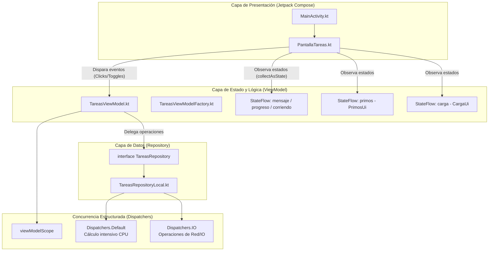
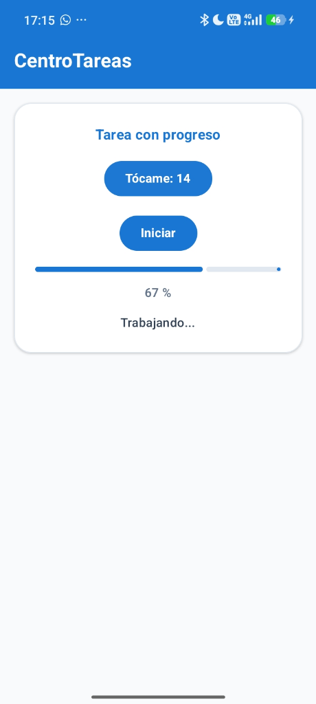
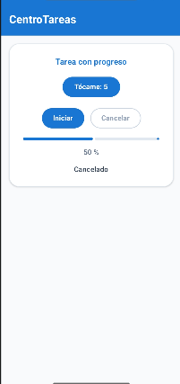
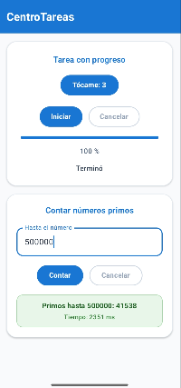
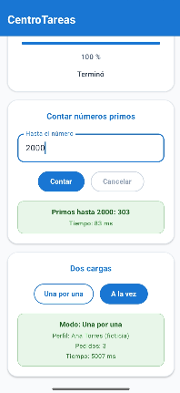
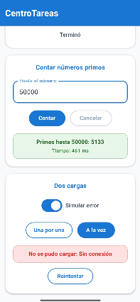

# CentroTareas: que la pantalla nunca se congele

**Laboratorio N° 14: Hilos en Android**  
**Desarrollado por:** Jesús Rocha  
**Docente:** Juan León S.  
**Institución:** Tecsup, Departamento de Tecnología Digital  
**Curso:** Programación en Móviles  

---

## Descripción del Proyecto

**CentroTareas** es una aplicación móvil desarrollada en **Kotlin** con **Jetpack Compose Material 3** que implementa los principios fundamentales de la concurrencia moderna, programación reactiva y arquitectura limpia en Android.

El objetivo central del laboratorio es comprender en profundidad el ciclo de vida del hilo principal (**Main / UI Thread**), prevenir congelamientos de pantalla y errores **ANR (Application Not Responding)**, y estructurar tareas asíncronas mediante **Kotlin Coroutines**, **StateFlow**, **Job** y despachadores optimizados (`Dispatchers.Default` y `Dispatchers.IO`).

### Aspectos Clave Implementados
* **Prevención de congelamiento:** Reemplazo de bloqueos síncronos (`Thread.sleep`) por corrutinas no bloqueantes con `withContext`.
* **Programación reactiva con StateFlow:** Emisión unidireccional de estados inmutables hacia la UI mediante `StateFlow<T>`.
* **Cancelación cooperativa:** Detención inmediata de tareas intensivas de CPU mediante `Job.cancel()` y llamadas continuas a `ensureActive()` sin demoras artificiales.
* **Procesamiento paralelo estructurado:** Comparación de tiempos entre ejecuciones secuenciales y concurrentes utilizando `async` y `await()` dentro de `coroutineScope`.
* **Resiliencia y recuperación de errores:** Aislamiento de fallos de red simulados con `try/catch`, preservación estricta de `CancellationException` y opción de reintento interactivo.
* **Cero fugas de memoria:** Gestión estricta del ciclo de vida con `viewModelScope` (sin `GlobalScope`, `runBlocking` ni `Thread.sleep` en el código final).

---

## Arquitectura del Sistema (MVVM + Repository)

La aplicación sigue el patrón de arquitectura recomendada por Google: **Model-View-ViewModel (MVVM)** combinado con el patrón **Repository**, manteniendo una estricta separación de responsabilidades y eliminando cualquier dependencia de `Context` en las capas lógicas.



---

## Estructura de Paquetes

```text
com.rocha.centrotareas/
│
├── MainActivity.kt                      # Punto de entrada de la actividad (setContent)
│
├── data/
│   ├── TareasRepository.kt              # Contrato de datos para operaciones pesadas y remotas
│   └── TareasRepositoryLocal.kt         # Implementación local con simulación de demoras y cálculo de primos
│
├── model/
│   └── Estados.kt                       # Interfaces selladas de estado: PrimosUi y CargaUi
│
├── ui/
│   ├── PantallaTareas.kt                # Interfaz completa en Compose (3 tarjetas interactivas)
│   └── theme/
│       ├── Color.kt                     # Paleta de colores Material 3
│       ├── Theme.kt                     # Tema global CentroTareasTheme
│       └── Type.kt                      # Definición tipográfica
│
└── viewmodel/
    ├── TareasViewModel.kt               # Lógica de corrutinas, medición de tiempos y StateFlows
    └── TareasViewModelFactory.kt        # Factoría para inyección manual del repositorio
```

---

## Tabla de Pruebas de Aceptación (Paso 8)

| # | Prueba de Aceptación | Resultado Esperado | Estado |
|:---:|:---|:---|:---:|
| **1** | **Tarea larga:** pulsar el botón *Tócame* mientras trabaja | El contador de toques se incrementa continuamente sin congelar la pantalla. | **Superado** |
| **2** | **Logcat con filtro `HILO`:** traza de hilos de ejecución | `Antes: main` y `Despues: main`; `Dentro: DefaultDispatcher-worker-X`. | **Superado** |
| **3** | **Iniciar la tarea con progreso:** avance de barra | La barra avanza fluidamente de 0 a 100 % en $\approx 4\text{ s}$. | **Superado** |
| **4** | **Cancelar a mitad:** pulsación del botón *Cancelar* | La barra se congela en el porcentaje actual, muestra *"Cancelado"* y se puede reiniciar. | **Superado** |
| **5** | **Pulsar *Iniciar* dos veces seguidas:** prevención de doble tarea | No se lanzan dos corrutinas concurrentes (el botón queda deshabilitado mientras corre). | **Superado** |
| **6** | **Primos hasta 1000:** precisión del algoritmo matemático | Devuelve exactamente **168 primos**. | **Superado** |
| **7** | **Primos con $N$ grande ($N = 500000$):** cálculo pesado | La pantalla nunca se cuelga, el contador *Tócame* responde y *Cancelar* detiene el bucle. | **Superado** |
| **8** | **Carga *Una por una*:** tiempo secuencial | Tarda $\approx 5000\text{ ms}$ ($2\text{ s} + 3\text{ s}$) y muestra perfil y pedidos correctamente. | **Superado** |
| **9** | **Carga *A la vez*:** tiempo concurrente | Tarda $\approx 3000\text{ ms}$ ($\max(2\text{ s}, 3\text{ s})$), logrando una reducción de latencia del 40%. | **Superado** |
| **10** | **Error simulado + Reintentar:** resiliencia de fallo | Muestra recuadro rojo con error; al apagar switch y reintentar, muestra éxito sin crasheos. | **Superado** |
| **11** | **Rotación de pantalla durante la tarea:** retención de estado | La corrutina continúa su cómputo en el ViewModel y el progreso no se reinicia a cero. | **Superado** |
| **12** | **Inspección de código (`git grep`):** buenas prácticas | `git grep` confirma 0 ocurrencias de `GlobalScope`, `runBlocking` o `Thread.sleep`. | **Superado** |

---

## Observación del Paso 1: El Problema (Pantalla Congelada)

### 1. ¿Qué pasa con la pantalla?
Al pulsar el botón **"Tarea larga (MAL)"**, la aplicación deja de responder inmediatamente durante 4 segundos completos:
* El botón **"Tócame: n"** no responde a las pulsaciones y el contador no incrementa.
* Las animaciones del sistema (*ripple effect*, toques visuales) quedan completamente suspendidas.
* La interfaz da la apariencia visual de estar bloqueada (*colgada*).

### 2. ¿Por qué no se ve "Trabajando..."?
En el código se ejecutaba:
```kotlin
_mensaje.value = "Trabajando..."
Thread.sleep(4000)
_mensaje.value = "Terminó"
```
El hilo principal (**Main Thread**) despacha tanto el código Kotlin secuencial como el ciclo de recomposición y dibujo de Jetpack Compose a través del `Looper` / `MessageQueue` y el `Choreographer`. Al ejecutar `Thread.sleep(4000)` en el hilo principal, éste se suspende físicamente antes de que pueda despachar el mensaje de renderizado de *"Trabajando..."*. Cuando despierta 4 segundos después, la variable ya fue modificada a *"Terminó"*, por lo que Compose solo dibuja el valor final, perdiendo por completo el estado intermedio visual.

### 3. ¿Qué crees que mostraría Android si la espera fuera de 10 segundos?
Si el hilo principal permanece ocupado sin procesar eventos de entrada o despachar fotogramas por **más de 5 segundos**, el sistema operativo detecta la pérdida de respuesta y despliega el diálogo crítico del sistema **ANR (Application Not Responding)**:
> *"CentroTareas no responde. ¿Quieres cerrarla o esperar?"*

Este diálogo ofrece al usuario la opción de forzar el cierre de la aplicación (*Force Close*), deteriorando drásticamente la experiencia de usuario y penalizando la aplicación en Google Play Vitals.

---

## Soluciones Implementadas por Pasos

### Paso 2 · Mover la tarea larga a una corrutina (`withContext`)
Se reemplazó el bloqueo de `Thread.sleep` por una corrutina lanzada con `viewModelScope.launch`, delegando la suspensión a `withContext(Dispatchers.Default)` con la función suspendible `delay(4000)`.
* **Comportamiento obtenido:** La UI permanece 100% interactiva. El contador *Tócame* incrementa fluidamente.
* **Verificación de hilos en Logcat (filtro `HILO`):**
  * `Antes: main` (Hilo principal, actualiza mensaje inicial).
  * `Dentro: DefaultDispatcher-worker-1` (Hilo trabajador del pool de fondo en suspensión).
  * `Despues: main` (Retorno automático al hilo principal para publicar el mensaje final).

### Paso 3 · Barra de progreso con StateFlow
Se expuso un flujo inmutable `progreso: StateFlow<Float>` en el ViewModel con valores normalizados de `0f` a `1f`.
* Un bucle de 100 iteraciones en `withContext(Dispatchers.Default)` actualiza el progreso cada 40 ms (`i / 100f`), completando 4 segundos de forma suave.
* En Compose se enlaza mediante `LinearProgressIndicator(progress = { progreso })` y un indicador textual del porcentaje (`(progreso * 100).toInt() %`).

### Paso 4 · Cancelar la tarea con Job
Se añadió una referencia `trabajo: Job?` y el estado reactivo `corriendo: StateFlow<Boolean>`.
* **Prevención de concurrencia:** Si la tarea ya corre, nuevas invocaciones se ignoran de inmediato.
* **Cancelación cooperativa:** `cancelar()` llama a `trabajo?.cancel()`, deteniendo de inmediato el ciclo de espera en `delay()`, fijando el texto en *"Cancelado"* y congelando la barra.
* **Garantía en ciclo de vida:** El bloque `finally` asegura que `_corriendo.value = false` se asigne invariablemente ante éxito o cancelación.

### Paso 5 · Contar números primos en Dispatchers.Default con cancelación
Se implementó un algoritmo intensivo de procesamiento matemático para contar números primos en el rango `2..hasta`.
* **Cancelación sin demoras:** En cada vuelta del bucle se invoca `ensureActive()`, lo que verifica el estado del Job y lanza `CancellationException` de inmediato, liberando la CPU sin pausas artificiales.
* **Optimización algorítmica:** La verificación `esPrimo(n)` evalúa divisores con `while (d.toLong() * d <= n)` hasta $\sqrt{n}$, evitando sobrecargas de funciones trigonométricas/raíz y previniendo desbordamientos aritméticos de 32 bits.
* **Manejo de excepciones:** Se captura `CancellationException`, se transiciona al estado `PrimosUi.Cancelado` y se relanza con `throw e` para mantener el contrato de corrutinas intacto.

### Paso 6 · Dos cargas a la vez con async
Se evaluó empíricamente el beneficio del paralelismo estructurado comparando llamadas secuenciales frente a concurrentes.
* **Secuencial (`cargarUnaPorUna`):** `cargarPerfil()` (2 s) + `cargarPedidos(false)` (3 s) $\approx$ **5000 ms**.
* **Paralelo (`cargarALaVez`):** Utiliza `coroutineScope` y dispara dos tareas simultáneas con `async`, esperando ambas con `await()`:
  $$\text{Tiempo total} = \max(2000, 3000) \approx 3000\text{ ms} \quad \text{(40\% de ahorro de tiempo)}$$

### Paso 7 · Estados de error y reintento
Se incorporó el interruptor `Switch` con el texto *"Simular error"* para validar la tolerancia a fallos.
* **Aislamiento de fallos:** Se protegen las llamadas en un bloque `try/catch` que reenvía `CancellationException` y atrapa `Exception`, evitando que una `IOException` cierre la aplicación.
* **Recuperación:** La interfaz muestra un recuadro de advertencia rojo suave (`#FEE2E2`) con el mensaje `"No se pudo cargar: Sin conexión"` y ofrece el botón **"Reintentar"**, el cual vuelve a lanzar la carga paralela una vez corregido el problema.

---

## Para Pensar: Respuestas a Preguntas Teóricas

### 1. ¿Por qué no se veía "Trabajando..." en el Paso 1?
Porque las instrucciones `_mensaje.value = "Trabajando..."`, `Thread.sleep(4000)` y `_mensaje.value = "Terminó"` se ejecutaban de manera estrictamente secuencial sobre el **mismo hilo principal (Main / UI Thread)**. 

En Android, la actualización de un estado reactivo no redibuja los píxeles de manera instantánea; en su lugar, encola una solicitud de recomposición y dibujo en la cola de mensajes (`MessageQueue`) gestionada por el `Looper` y coordinada por el reloj de refresco de pantalla (`Choreographer`, típicamente cada 16.6 ms para 60 Hz). Al colocar `Thread.sleep(4000)`, el hilo principal se congeló antes de poder despachar la recomposición de *"Trabajando..."*. Cuando el hilo despertó tras 4 segundos, el valor fue inmediatamente sobrescrito con *"Terminó"*, procesándose únicamente el fotograma con el mensaje final.

### 2. ¿Qué diferencia hay entre `Thread.sleep` y `delay`?
| Característica | `Thread.sleep(ms)` | `delay(ms)` |
|:---|:---|:---|
| **Naturaleza** | Bloqueante a nivel de sistema operativo (*Blocking*). | Suspendible a nivel de corrutina (*Non-blocking / Suspending*). |
| **Efecto en el hilo** | Bloquea y monopoliza el hilo físico. Nada más puede ejecutarse en él. | Libera el hilo físico para que atienda otras corrutinas o eventos de UI. |
| **Uso en el Main Thread** | **Prohibido:** Congela la pantalla y detona errores ANR. | **Seguro:** Suspende la corrutina sin afectar la fluidez de la interfaz. |
| **Mecanismo de tiempo** | Pausa directa del hilo en el scheduler del sistema operativo. | Temporizador programado por el runtime de corrutinas (`Continuation`). |

### 3. ¿Por qué `Dispatchers.Default` para los primos y `Dispatchers.IO` para la red?
* **`Dispatchers.Default` (Trabajo pesado en CPU):** Está diseñado para cómputo intensivo (cálculos matemáticos, compresión, parseo de datos). Su número de hilos de trabajo está restringido exactamente al número de núcleos físicos del procesador (o mínimo 2). Si se crearan cientos de hilos para tareas de CPU pura, el procesador colapsaría por la sobrecarga del cambio de contexto (*context switching*). Al mantener un hilo por núcleo, se logra la máxima tasa de procesamiento real.
* **`Dispatchers.IO` (Operaciones de entrada/salida):** Está optimizado para tareas bloqueantes que esperan respuestas externas (llamadas HTTP, consultas a base de datos Room, lectura de archivos). En estas operaciones, los hilos pasan el 99% del tiempo inactivos esperando que un socket o disco responda, sin consumir ciclos de CPU. Por ello, `Dispatchers.IO` puede escalar elásticamente hasta **64 hilos concurrentes** (o el número de núcleos si es mayor), permitiendo despachar múltiples solicitudes simultáneas de I/O sin saturar el sistema.

### 4. ¿Qué pasaría con la corrutina si el usuario cierra la pantalla? ¿Qué papel cumple `viewModelScope`?
* **Riesgo sin control de ciclo de vida:** Si una corrutina se lanzara en un ámbito global como `GlobalScope` o sin atarse al ciclo de vida, la corrutina continuaría ejecutándose en segundo plano aunque el usuario haya salido de la pantalla. Esto consume batería, gasta CPU innecesariamente y mantiene en memoria referencias implícitas a la actividad o vistas destruidas, provocando una **fuga de memoria (*memory leak*)**.
* **El papel de `viewModelScope`:** Es un `CoroutineScope` provisto por Android Jetpack estrictamente vinculado al ciclo de vida del `ViewModel`. Internamente cuenta con un `SupervisorJob()` atado a la función `onCleared()`. Cuando el usuario cierra la pantalla o la actividad finaliza, `viewModelScope` cancela de forma automática todas las corrutinas hijas activas, liberando hilos, cerrando conexiones y destruyendo los recursos de manera limpia y predecible.

### 5. ¿Por qué `async` tarda 3 s y no 5 s? ¿Qué pasa si una de las dos cargas falla?
* **¿Por qué tarda 3 s?**  
  En la carga secuencial (`cargarUnaPorUna`), la segunda operación no puede comenzar hasta que la primera finalice por completo:
  $$t_{\text{secuencial}} = t_{\text{perfil}} + t_{\text{pedidos}} = 2000\text{ ms} + 3000\text{ ms} = 5000\text{ ms}$$
  Con `async`, ambas llamadas se lanzan al mismo tiempo en hilos independientes del pool de trabajadores. Ambas corren de forma concurrente, por lo que el tiempo de espera para el usuario es únicamente el de la tarea más lenta:
  $$t_{\text{paralelo}} = \max(t_{\text{perfil}}, t_{\text{pedidos}}) = \max(2000\text{ ms}, 3000\text{ ms}) \approx 3000\text{ ms}$$
* **¿Qué pasa si una de las dos cargas falla?**  
  Gracias al principio de **concurrencia estructurada (*structured concurrency*)** que rige a `coroutineScope`:
  1. Si una corrutina hija falla (por ejemplo, `cargarPedidos` lanza `IOException("Sin conexión")`), la excepción se propaga de inmediato al ámbito padre `coroutineScope`.
  2. El ámbito padre cancela de forma automática e inmediata a todas las demás corrutinas hermanas que aún sigan ejecutándose (en este caso, cancelaría la carga del perfil si estuviera corriendo), impidiendo tareas huérfanas en segundo plano.
  3. El bloque `coroutineScope` retransmite la excepción para ser capturada por el bloque `catch (e: Exception)`, permitiendo actualizar el estado a `CargaUi.Error` y mostrando el mensaje de error en la UI de forma controlada y sin fallos fatales.

---

## Galería de Evidencias (Capturas Reales de Ejecución)

A continuación se presentan las capturas del funcionamiento en el emulador/dispositivo real, demostrando el cumplimiento de los contratos funcionales del laboratorio:

| 1. Tarea con Progreso Activa | 2. Cancelación a Mitad de Camino | 3. Cálculo Pesado de Primos ($N = 500000$) |
|:---:|:---:|:---:|
|  |  |  |
| *La barra avanza al 67% mientras el contador 'Tócame' sigue sumando sin congelar la pantalla.* | *El botón 'Cancelar' detiene la tarea al 50% y fija el estado 'Cancelado' de inmediato.* | *Cálculo de 41,538 primos en 2351 ms en Dispatchers.Default manteniendo fluidez total.* |

| 4. Carga Secuencial ("Una por una") | 5. Error Simulado y Botón Reintentar |
|:---:|:---:|
|  |  |
| *Modo secuencial tardando ~5007 ms para cargar perfil (Ana Torres) y 3 pedidos.* | *Manejo tolerante a fallos: muestra recuadro rojo y ofrece el botón 'Reintentar'.* |
