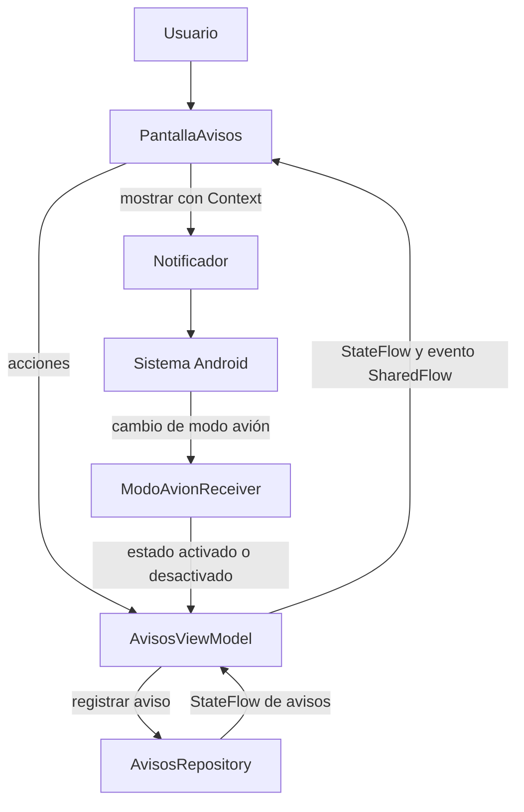
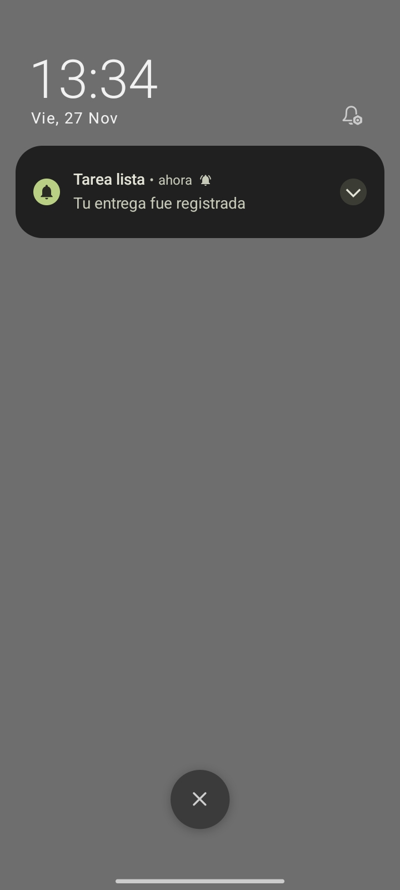
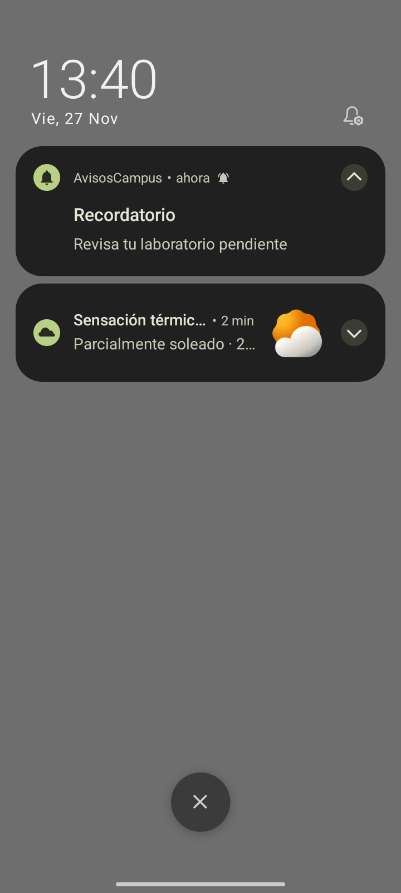
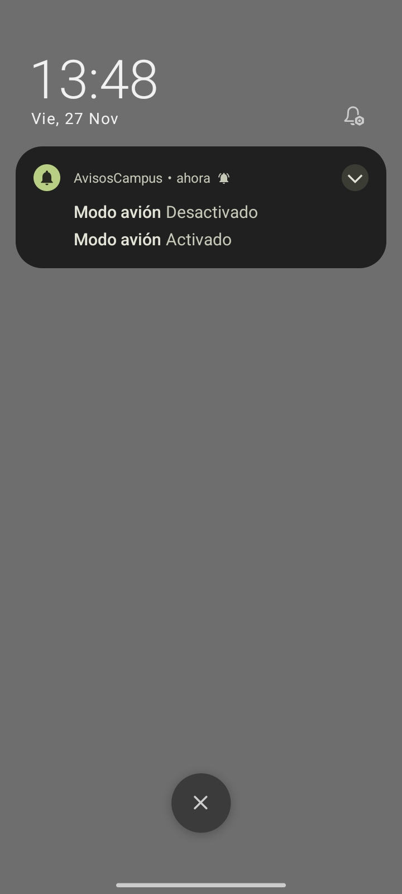
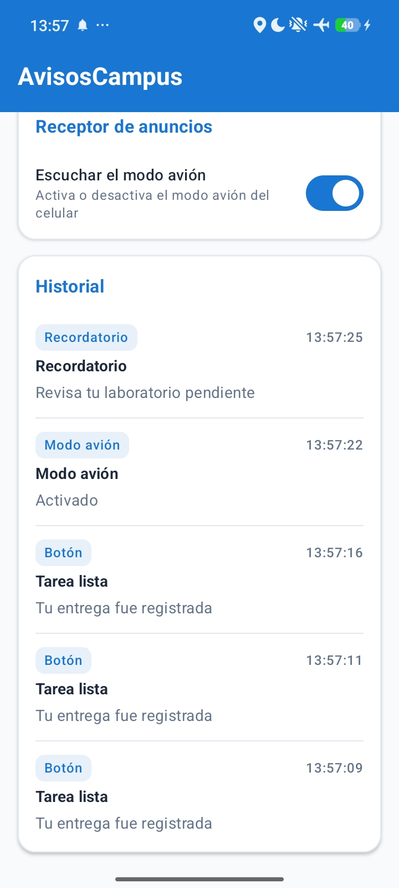
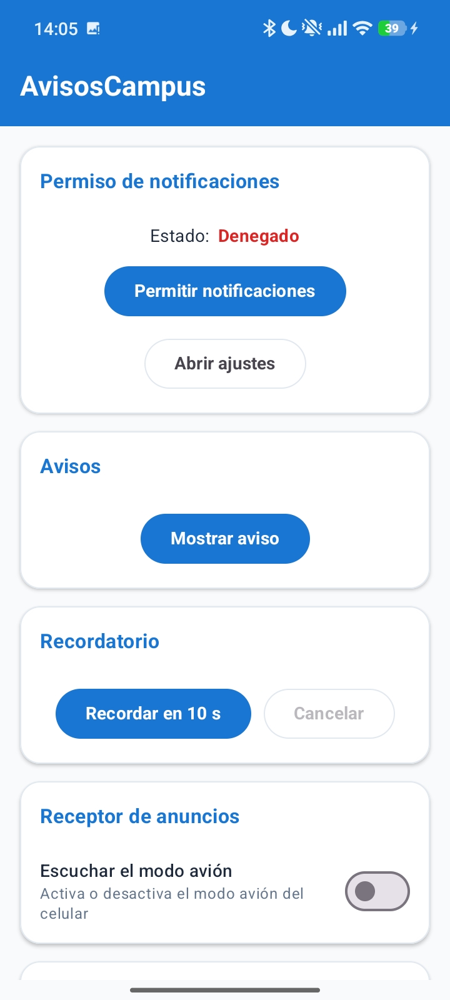

# AvisosCampus

Aplicación Android hecha con Kotlin y Jetpack Compose para mostrar avisos locales, programar un recordatorio de 10 segundos y escuchar los cambios del modo avión. Los avisos quedan registrados en un historial en memoria, con el más reciente primero. Sigue una arquitectura MVVM con una interfaz de repositorio.

## Cómo ejecutar

Abre `Semana15` en Android Studio, sincroniza Gradle y ejecuta el módulo `app` en un dispositivo o emulador. Para probar la solicitud del permiso de notificaciones, usa Android 13 (API 33) o superior. El proyecto no necesita internet ni claves.

## Estructura de paquetes

```text
com.tecsup.avisoscampus/
├── AvisosApp.kt                 Canal de notificaciones al iniciar
├── MainActivity.kt              Entrada de la interfaz Compose
├── model/
│   └── Modelos.kt               Aviso, Origen y PermisoUi
├── data/
│   └── AvisosRepository.kt      Interfaz y repositorio en memoria
├── notificacion/
│   └── Notificador.kt           Permiso, canal y notificación
├── receiver/
│   └── ModoAvionReceiver.kt     Escucha cambios del modo avión
├── viewmodel/
│   ├── AvisosViewModel.kt        Estado y eventos de la pantalla
│   └── AvisosViewModelFactory.kt
└── ui/
    ├── PantallaAvisos.kt         Controles y registro del receptor
    ├── HistorialAvisos.kt        Últimos 20 avisos
    └── theme/                   Colores y tema visual
```

## Arquitectura MVVM



El ViewModel decide qué aviso generar y lo registra mediante la interfaz `AvisosRepository`. La pantalla recibe el evento y llama a `Notificador`, porque esa capa sí tiene acceso a `Context`. El receptor se registra únicamente mientras el switch está activo y se quita en `onDispose`.

## Capturas

### Notificación en el panel



### Recordatorio



### Modo avión



### Historial



### Permiso denegado



## Pruebas de aceptación

El autor verificó en su dispositivo los casos de la guía:

- [x] El canal «Avisos» aparece en Ajustes.
- [x] El botón de permiso abre el cuadro de Android y actualiza la etiqueta.
- [x] «Mostrar aviso» crea la notificación «Tarea lista».
- [x] Dos pulsaciones crean dos notificaciones distintas.
- [x] Al tocar una notificación, se abre la app y la notificación desaparece.
- [x] El recordatorio cuenta 10 segundos y muestra el aviso al terminar.
- [x] El recordatorio llega con la app minimizada.
- [x] Al cancelar el recordatorio, no llega el aviso.
- [x] Con el switch activo, los cambios del modo avión generan avisos.
- [x] Con el switch apagado, los cambios del modo avión no generan avisos.
- [x] Con el permiso denegado, el aviso queda en el historial y la app sigue abierta.
- [x] Al rotar durante el recordatorio, la cuenta continúa.
- [x] El ViewModel no usa `Context` y el receptor se desregistra en `onDispose`.

## Para pensar

**¿Por qué una notificación necesita un canal y un permiso? ¿Qué pasa si falta cada uno?** En Android 8 o superior, el canal agrupa las notificaciones y permite al usuario controlar su importancia. Sin un canal registrado, la notificación no se muestra correctamente. En Android 13 o superior, la app también debe solicitar `POST_NOTIFICATIONS`; si el usuario lo niega, la app no puede publicar avisos, aunque sí puede guardarlos en el historial.

**¿Por qué el ViewModel emite un evento y no muestra la notificación él mismo?** Mostrarla requiere APIs de Android y un `Context`. El ViewModel solo decide y registra el aviso; la pantalla recibe el evento y usa `Notificador`. Así se mantiene separado el estado de la app del acceso al sistema.

**¿Qué pasa si usas el mismo ID en dos notificaciones?** La segunda reemplaza a la primera en el panel. Por eso cada aviso usa su propio `id` al llamar a `notify`.

**¿Por qué `onReceive` debe ser corto y por qué hay que quitar el receptor al salir?** `onReceive` se ejecuta durante un tiempo limitado: si bloquea el hilo o hace trabajo largo, la app puede dejar de responder. Quitar el receptor evita que siga recibiendo eventos cuando la pantalla ya no lo necesita y previene fugas de memoria.

**¿En qué casos usarías una notificación local y en cuáles una push de Firebase?** Una notificación local sirve para eventos que la app o el dispositivo conocen por sí mismos, como un recordatorio o el modo avión. Una push sirve cuando un servidor debe avisar sobre algo nuevo, como un mensaje o un cambio remoto, incluso si la app no está abierta.
